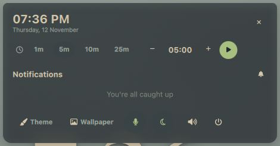
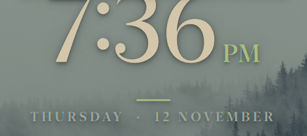
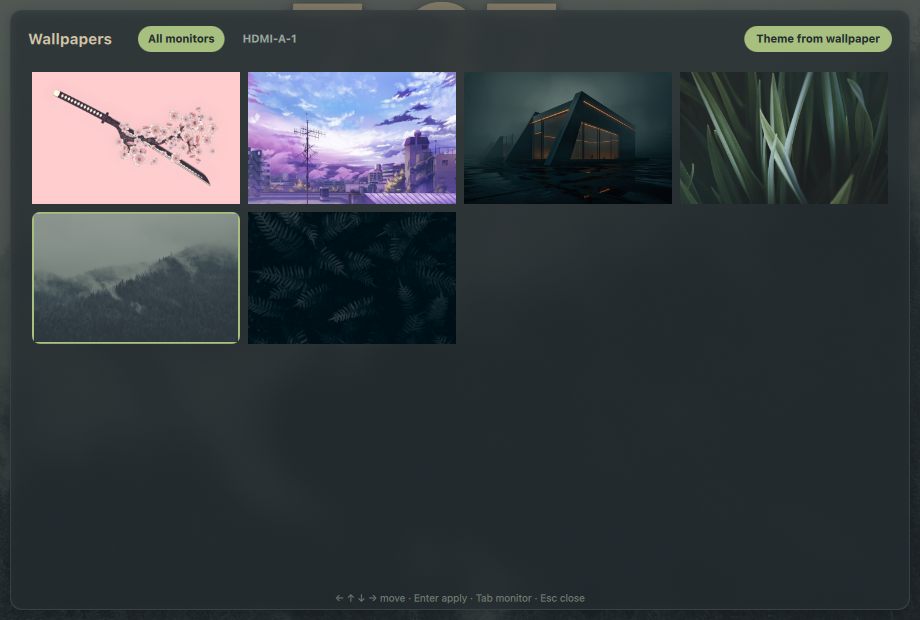
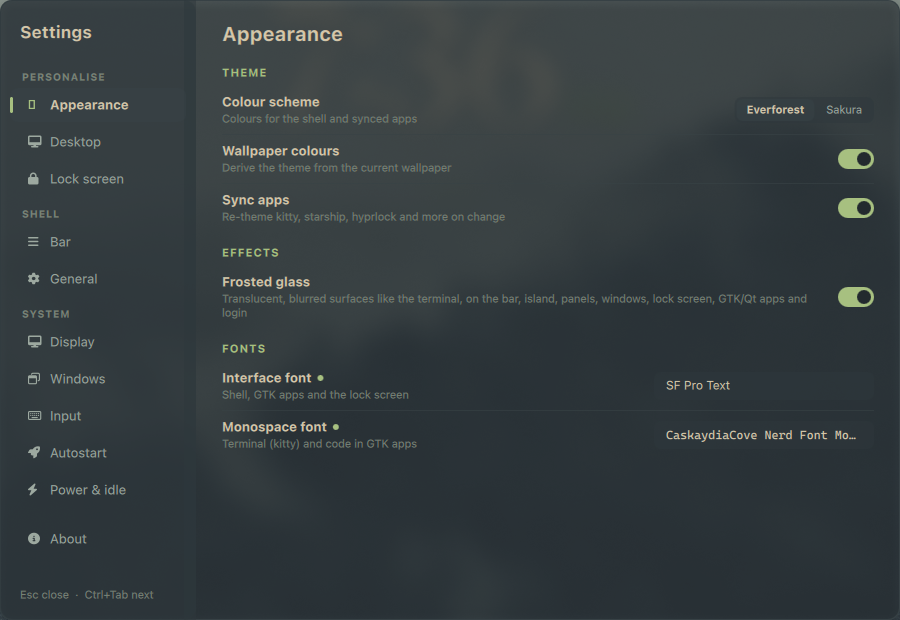
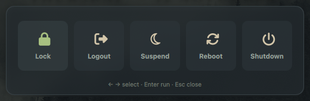
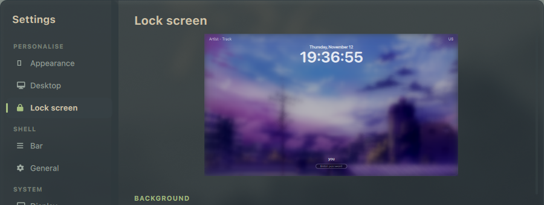

# Cozytile

**A cozy, good-looking desktop for Hyprland.**

Cozytile turns Hyprland into a complete, pleasant desktop: a floating top bar, a dynamic island for notifications
and media, a Spotlight-style launcher, a settings app, a desktop clock, and themed dotfiles for your terminal,
prompt, lock screen and apps. Everything shares one colour palette, so the whole desktop looks like it belongs together.

It is a Wayland-native take on the [Cozytile](https://github.com/Darkkal44/Cozytile) look, originally made for Qtile/X11.


---

## Contents

- [A tour](#a-tour)
- [Get started](#get-started)
- [Requirements](#requirements)
- [Using Cozytile](#using-cozytile)
- [Keyboard shortcuts](#keyboard-shortcuts)
- [Settings](#settings)
- [Command line and scripting](#command-line-and-scripting)
- [Troubleshooting](#troubleshooting)
- [Project layout](#project-layout)

---

## A tour

### The top bar

A floating bar with two tones and rounded caps. It holds your workspaces, the focused window's title, and the
system at a glance: CPU, RAM, temperature, network, volume, battery, tray icons and the clock.
Click the logo for the system menu. Items you don't need can be hidden in Settings, and the bar drops optional
items automatically on narrow screens.


### The launcher

Press `Super + Space` (or `Super + D`) and start typing. It searches:

- **Apps** and **open windows**, with fuzzy matching (`ffx` finds Firefox).
- **Calculator** and **unit and currency conversion**, as you type (`12 km to mi`).
- **Files** (prefix `/`), **system actions**, and **web search** (`g`, `yt`, `gh`, `w`, `so`, `aur`, `aw`, `mdn` followed by your text).
- **Emoji** (prefix `:`), with your recent ones first.
- **Clipboard history** (type `clip`).
- **Shell commands** (prefix `>`).

### The dynamic island

The island sits at the top centre and does three jobs:

- **Banners**: notifications and feedback pop up here, so there are no separate OSD popups. Volume, microphone and
  brightness changes show here too.
- **Media**: shows what's playing, with play/pause and skip controls.
- **Panel**: click it to open the full card, with the timer, notification history, and quick actions (theme, wallpaper, microphone, night light, volume, power).



### Notifications

Cozytile includes its own notification daemon, so there's nothing extra to install. You get:

- Popups and a notification history you can open from the island.
- Actions on notifications, and progress bars.
- **Do-Not-Disturb**: silences banners while you work. Toggle it from the island's notification panel.

### Timers

The island has a built-in timer with quick presets (1m, 5m, 10m, 25m) or a custom time. A countdown chip
appears in the island while it runs, and the timer rings, with a pulse and sound, when it finishes. Click the island to silence it.

A timer running inside a web page can't be shown here, because browsers don't expose it to the desktop.
If the page sends a notification, it appears as a normal banner.

### The desktop clock

A clock on your wallpaper, behind your windows and click-through, so it never gets in the way.
Pick a style in Settings: **minimal**, **stacked**, or **analog**. You can also choose its corner and size.



### Wallpapers

A thumbnail picker (`Super + Ctrl + O`) shows the images in the folders you choose. Each monitor can have its own
wallpaper, and "Theme from wallpaper" builds the whole colour scheme from the picture you choose.
Cozytile doesn't ship wallpapers, so point it at your own folder.



### Themes

Two built-in colour schemes, **Everforest** (default) and **Sakura**, plus an optional **from-wallpaper** theme
that derives its colours from your picture. Switch with `Super + Shift + T`. A theme change re-colours the bar,
island, launcher and settings, and re-themes the apps you've hooked up (terminal, prompt, lock screen, GTK and Qt).



### Frosted glass

Turn on **Frosted glass** in Settings → Appearance for a translucent look. Panels, the bar, the island, windows, the
lock screen and themed apps get a blurred, palette-tinted surface, much like a frosted terminal window.
Off gives you solid surfaces.

### Power menu

`Super + X` opens a menu to **lock**, **log out**, **suspend**, **reboot**, or **shut down**. Use the arrow keys
and `Enter`, or click.



### Lock screen

Your lock screen is themed to match the desktop, and you can customise it in Settings → Lock screen:

- Pick a background image (or use your desktop wallpaper).
- Set the blur and brightness of the background.
- Choose the clock size (large, medium or small), font, and 12- or 24-hour time.



### Global menu

Turn on **Global menu** in Settings → Bar. The left of the bar then shows the focused app's menus, the way
macOS does. Menus that don't fit collapse behind a `»` button. Some apps need a small setup first; see
[Global menu setup](#global-menu-setup).

### Display, input and power

- **Night light** warms the screen, either all the time or on a schedule. You can also dim all screens in software.
- **Monitors**: resolution, refresh rate, scale, rotation, position, VRR, and on/off. Changes revert after 15 seconds
  unless you keep them, so you can't lock yourself out of a display.
- **Keyboard and mouse**: keyboard layouts and XKB options, key repeat, pointer speed and acceleration,
  focus-follows-mouse, touchpad options, and cursor hiding.
- **Power and idle**: when to lock, turn off the screen, and suspend.
- **Autostart**: run any command or app at login, with an app picker. You can test-run, reorder and toggle entries.
- **Lock-key hints**: the island tells you when Caps Lock, Num Lock or Scroll Lock is on.
- **Privacy**: the island shows when an app is using your microphone or camera, and which app.

### Hyprland, made easy

Windows, gaps, rounding, borders, opacity, blur, shadows and animations all have sliders and toggles in
Settings → Windows. Changes apply live and survive reloads. Hyprland's own config stays readable and
hand-editable, and the settings app writes only the values you change.

---

## Get started

On Arch or CachyOS, with an internet connection:

```sh
git clone https://github.com/shahriar-ridom/cozytile.git
cd cozytile
./setup.sh --dry-run         # 1. preview every change (touches nothing)
./setup.sh --packages        # 2. install the packages Cozytile needs
./setup.sh                   # 3. install the shell and link the dotfiles
```

Then log out, choose **Hyprland** at the login screen, and log in. That's it.

Want to try it in your current session first? Run `~/.config/quickshell/cozytile/scripts/launch.sh`.

`setup.sh` is safe to re-run. Anything it would replace is first moved to `*.bak-<timestamp>`.

### Other ways to install

| I want… | Run |
|---|---|
| The full desktop (recommended) | `./setup.sh` |
| Only the bar, island and launcher, with my own Hyprland config | `./install.sh` |
| To try it without installing | `qs -p .` from the repo folder |
| The Cozytile login screen (SDDM) | `./setup.sh --sddm` (needs sudo) |
| To start with the Sakura theme | `./setup.sh --theme sakura` |

> The installed shell is a **copy** in `~/.config/quickshell/cozytile`. After you edit the QML, run `./install.sh`
> again, or use `qs -p .` to run straight from the repo.

### What the installer changes

- The shell goes to `~/.config/quickshell/cozytile`.
- Your themed config files are generated into `~/.config/cozytile/generated/`.
- These are **symlinked to this repo**, so editing them here updates your desktop right away:
  `~/.config/hypr`, `kitty`, `~/.zshrc`, and the GTK 3/4 settings. Qt (`qt6ct`) is rendered as well.

Edit the dotfiles in this repo, not in `~/.config`.

Machine-specific settings (monitor layout, GPU) go in `dotfiles/hypr/config/local.lua`. `setup.sh` creates it from
`local.example.lua`. It is git-ignored, so it never gets committed.

### Undo and uninstall

```sh
./rollback.sh                # restores the previous shell install
./uninstall.sh               # removes the installed shell (your settings are kept)
./uninstall.sh --purge       # also removes your saved settings
```

The dotfile symlinks aren't removed automatically. To go back to your old config, restore the `*.bak-<timestamp>`
copies next to them.

---

## Requirements

| Needed | Why |
|---|---|
| **Hyprland 0.55 or newer** (Lua config) | The window manager. The bundled config is `hyprland.lua` |
| **Quickshell 0.3 or newer**, built with Hyprland, PipeWire, MPRIS, Notifications, SystemTray, UPower and Networking | The bar, island, launcher and settings app |
| **CaskaydiaCove Nerd Font** | Icons and monospace text. Any Nerd Font works; set `Theme.fontMono` in `config/Theme.qml` |
| **SF Pro Text** (optional) | The UI font. It isn't in the Arch repos, so Qt falls back to another sans font. Set `Theme.font` to any font you like |

Optional extras, each one unlocking a feature when installed:

| Tool | Unlocks |
|---|---|
| `awww`, `swww`, `hyprpaper` or `swaybg` | Wallpapers |
| `matugen` | The from-wallpaper theme |
| `hyprlock` | The lock screen |
| `hypridle` | Idle timeouts |
| `brightnessctl` | Screen brightness keys |
| `playerctl` | Media keys |
| `hyprshot` | Screenshots |
| `kitty`, `zsh`, `starship` | The themed terminal and prompt |
| `python3` + PyGObject | The global menu |

> **Important:** only one notification daemon can run at a time. Stop any others first (`dunst`, `swaync`, `mako`, …).

---

## Using Cozytile

### Mouse

- **Logo**: left-click for the launcher, right-click for the power menu, middle-click for wallpapers.
- **Volume**: click to mute, scroll to change, right-click for the output picker, middle-click to mute the mic.
- **Clock**: click to show the date.
- **Island**: click to expand, middle-click to play/pause. The island's notification panel has the Do-Not-Disturb toggle.
- **Workspace dots**: click or scroll to switch.

---

## Keyboard shortcuts

`Super` is the Windows/Command key. The full list lives in `dotfiles/hypr/config/binds.lua`.

**Apps and shell**

| Keys | Action |
|---|---|
| `Super + Return` | Terminal (kitty) |
| `Super + Shift + Return` | Floating terminal |
| `Super + B` | Browser (Zen) |
| `Super + C` | VS Code |
| `Super + N` | Neovim in the terminal |
| `Super + Space` or `Super + D` | Launcher |
| `Super + A`, `Super + Shift + N` or `Super + Shift + I` | Island (notifications, media, timer) |
| `Super + Shift + T` | Next theme |
| `Super + Ctrl + O` | Wallpaper picker |
| `Super + X` | Power menu |
| `Super + Ctrl + L` | Lock screen |

**Windows and layout**

| Keys | Action |
|---|---|
| `Super + Q` | Close window |
| `Super + V` | Toggle floating |
| `Super + Ctrl + C` | Centre a floating window |
| `Super + F` | Fullscreen (covers the bar) |
| `Super + Shift + F` | Maximise (keeps the bar and gaps) |
| `Super + S` | Toggle split direction |
| `Super + P` | Pseudo-tile |
| `Super + M` | Swap with master |
| `Super + H / J / K / L` | Move focus left / down / up / right |
| `Super + Shift + H / J / K / L` | Move the window in that direction |
| `Super + Mouse drag` | Move a window |
| `Super + Right-drag` | Resize a window |
| `` Super + ` `` | Toggle the scratchpad |
| `Super + O` | Toggle the Obsidian scratchpad |

**Workspaces**

| Keys | Action |
|---|---|
| `Super + 1 … 0` | Go to workspace 1–10 |
| `Super + Shift + 1 … 0` | Move the window to workspace 1–10 |
| `Super + Mouse wheel` | Previous / next workspace |

**Screenshots**

| Keys | Action |
|---|---|
| `Super + Shift + S` | Region |
| `Super + Ctrl + S` | Whole screen |
| `Super + Shift + W` | A window |

Screenshots are saved to `~/Pictures/Screenshots`.

**Session**

| Keys | Action |
|---|---|
| `Super + Shift + R` | Reload Hyprland |
| `Super + Shift + E` | Exit Hyprland |

**Media and hardware keys:** volume, mute, brightness, and play/pause/next/previous are bound by default. Volume
and brightness show their feedback in the island.

---

## Settings

Open the settings app by right-clicking the bar, or run `qs -c cozytile ipc call settings toggle`. You can also jump straight to a page:

```sh
qs -c cozytile ipc call settings open <page>
```

Pages: `appearance`, `desktop`, `lock screen`, `bar`, `general`, `display`, `windows`, `input`, `autostart`, `power`, `about`.

| Group | Page | What's in it |
|---|---|---|
| Personalise | **Appearance** | Colour scheme, from-wallpaper theme, app syncing, frosted glass, fonts |
| Personalise | **Desktop** | Desktop clock style, corner and size, wallpapers |
| Personalise | **Lock screen** | Background, blur, brightness, clock size, font, 12/24-hour time |
| Shell | **Bar** | Which items show, the global menu, window title, workspace numbers, temperature |
| Shell | **General** | Notifications, Do-Not-Disturb, OSD timing, reload and restart |
| System | **Display** | Night light, software dimming, monitors (resolution, refresh, scale, rotation, position, VRR) |
| System | **Windows** | Layout, gaps, rounding, borders, opacity, blur, shadows, animations |
| System | **Input** | Keyboard layouts, XKB options, key repeat, pointer speed, touchpad, cursor |
| System | **Autostart** | Commands and apps started at login |
| System | **Power & idle** | Lock, screen-off and suspend timeouts |
| | **About** | System info and config file locations |

**Good to know**

- Hyprland changes apply live and are saved to `~/.config/cozytile/generated/hypr/cozytile_settings.lua`, which loads
  after the shipped config. Your choices survive reloads.
- A small accent-coloured dot next to a setting means you've changed it from the default. Click the dot to go back.
- The settings app remembers the page you last used.
- Press `Esc` to close, and `Ctrl + Tab` for the next page.

### Settings file

Settings are saved to `~/.local/state/cozytile/settings.json` and reload live. Keys include `theme`,
`syncDotfiles`, `wallpaperDirs`, `wallpapers`, `wallpaperTheming`, `osdTimeout` (ms), `showWorkspaceNumbers`,
`showWindowTitle`, `globalMenu`, `dnd`, `showTemp`, `statsInterval` (ms), `frostedGlass` and `lockscreen`.
The settings app also stores `hypr` (Hyprland overrides), `monitors`, `autostart` and `idle`. Changes to those
take effect when the shell restarts.

Design tokens (fonts, bar height, margins, radii, animation timings) are in `config/Theme.qml`.

### Adding a theme

Add an entry to `palettes` in `config/Theme.qml` with the same keys as the existing ones
(`bg bg2 bg3 dim fg fg2 muted green blue yellow orange red purple accent workspaceActive`), then add its name to
`themeNames` and `themeLabels`. Every component uses semantic colour roles, so a new theme recolours everything automatically.

### Global menu setup

The global menu needs apps to run through XWayland, because Hyprland can't export menus from native Wayland windows.

- `scripts/menu-launchers.sh` writes launcher overrides for Dolphin, LibreWolf and Zen (plus Thunar and GIMP when
  `appmenu-gtk-module` is installed). Run it with `--remove` to undo.
- Start those apps from the launcher or a desktop entry. Only apps started after the shell is running export a menu.
- Firefox-family browsers also need `widget.gtk.global-menu.enabled` set to `true` in the profile (`user.js`).
- Some apps never export a menu. kitty has no global-menu support on Linux.

---

## Command line and scripting

Every action is an IPC call, so any keybind tool can use them:

```sh
qs -c cozytile ipc call launcher toggle
qs -c cozytile ipc call notifications toggle|clear|dnd
qs -c cozytile ipc call island toggle|close
qs -c cozytile ipc call timer start 5m|90s|1h30m|25:00   # also: stop, toggle, add 1m, status
qs -c cozytile ipc call workspace goto <n>|next|prev
qs -c cozytile ipc call wallpaper toggle
qs -c cozytile ipc call theme next|set sakura|get
qs -c cozytile ipc call audio up|down|mute|micMute
qs -c cozytile ipc call brightness up|down|kbdUp|kbdDown
qs -c cozytile ipc call nightlight toggle|on|off|status   # also: temperature 4000, dim 80
qs -c cozytile ipc call keys refresh
qs -c cozytile ipc call power toggle
qs -c cozytile ipc call settings toggle|open <page>
```

Re-render the themed dotfiles and reload apps for a theme from the command line:

```sh
~/.config/cozytile/theme-apply.sh sakura
```

Only apps you've set up are reloaded.

---

## Troubleshooting

| Problem | Fix |
|---|---|
| **No notifications** | Another daemon owns them. Check with `busctl --user status org.freedesktop.Notifications`, then stop it. |
| **Missing icons or empty boxes** | Install a Nerd Font and set `Theme.fontMono` in `config/Theme.qml`. |
| **Wallpaper doesn't change** | Run `scripts/wallpaper.sh /path/to/image.png` in a terminal to see the error. |
| **No temperature shown** | No sensor was found (`k10temp`, `coretemp` or `zenpower`). The item hides itself. |
| **Installer says a module is missing** | Your Quickshell build lacks a service module. Rebuild it with the modules listed in [Requirements](#requirements). |
| **Shell fails to load after editing QML** | One QML error stops the whole shell. Lint with `qmllint <files>`, then check the log with `qs -c cozytile log`. |
| **Something else looks wrong** | Check `~/.cache/quickshell`, or run `qs -c cozytile log`. |

On narrow screens, the bar drops optional items: network and temperature below 1500 px, and search, CPU and RAM below 1150 px.

---

## Project layout

| Path | What's inside |
|---|---|
| `shell.qml` | The entry point: IPC handlers, the bar, island, desktop clock, and overlays |
| `config/` | Settings, the theme, and the palette (`palettes.json`) |
| `services/` | Stateless services: audio, network, media, notifications, timer, frosted glass, and more |
| `modules/` | The UI, one folder per feature (bar, island, launcher, settings, power, wallpaper, clock, …) |
| `components/` | Shared widgets (toggle, dropdown, segmented control, slider, …) |
| `scripts/` | Helper scripts: wallpapers, theme switching, global menu, recent files |
| `dotfiles/hypr/` | Hyprland config (`hyprland.lua`, `config/*.lua`), idle, lock and helper scripts |
| `dotfiles/kitty`, `zsh`, `gtk`, `qt6ct`, `sddm` | Terminal, shell, toolkit and login-screen settings |
| `dotfiles/templates/` + `render.py` | Renders themed configs from `config/palettes.json` |
| `packages.txt` | Arch and CachyOS package list |
| `docs/screenshots/` | Screenshots used in this README |

---

## Credits

Cozytile's look is inspired by the original [Cozytile](https://github.com/Darkkal44/Cozytile) for Qtile.
Built with [Quickshell](https://quickshell.org) and [Hyprland](https://hyprland.org).
