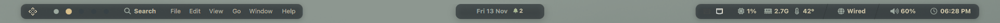
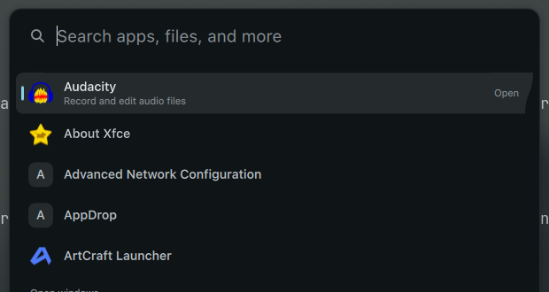

# Cozytile

**A cozy, good-looking Hyprland desktop for Wayland.** Cozytile is a Quickshell top bar, dynamic island, launcher,
notifications, and themed dotfiles, all sharing one colour palette. It is a Wayland-native take on the
[Cozytile](https://github.com/Darkkal44/Cozytile) look (originally Qtile/X11).





## Features

- **One floating top bar**: workspaces, window title, tray, media, CPU/RAM/temperature, network, volume, battery, clock.
- **Dynamic island**: shows what's playing and pops up notification banners. Click it to open the media card,
  notification history, quick actions, and timer.
- **Launcher**: searches your installed apps, plus calculator, emoji, and clipboard history.
- **Notifications**: a built-in notification daemon with history, actions, Do-Not-Disturb, and progress bars.
- **Feedback at a glance**: volume, mic, and brightness changes show in the island, with no separate OSD popups.
- **Wallpapers**: a thumbnail picker that remembers your choice per monitor.
- **Themes**: Everforest (default) and Sakura, plus an optional "from wallpaper" theme (via matugen). Switch live with one key.
- **Whole-desktop look**: terminal, prompt, lock screen, GTK/Qt apps, and optionally the login screen all match the theme.

## Quick start

On Arch or CachyOS, with an internet connection:

```sh
git clone https://github.com/shahriar-ridom/cozytile.git
cd cozytile
./setup.sh --packages        # installs everything Cozytile needs (optional, but recommended)
./setup.sh                   # installs the shell and links the dotfiles
```

Then log out and back in, and choose **Hyprland** at the login screen. That's it.

> Not on Arch? Read [Requirements](#requirements) and install the packages listed in `packages.txt` by hand.

## Requirements

| Needed | Why |
|---|---|
| **Hyprland** (a version with the Lua config, 0.55 or newer) | the window manager Cozytile runs on. The bundled config is `hyprland.lua` |
| **Quickshell** (0.3 or newer, built with Hyprland, PipeWire, MPRIS, Notifications, SystemTray, UPower, Networking) | the bar, island, and launcher |
| **CaskaydiaCove Nerd Font** | icons and monospace text. Any other Nerd Font works. Set `Theme.fontMono` in `config/Theme.qml` |
| **SF Pro Text** (optional) | the UI text font. It isn't in the Arch repos, so Qt falls back to another sans font. Change `Theme.font` to any font you like |

Optional, and each one unlocks a feature if present: `awww`, `swww`, `hyprpaper`, or `swaybg` (wallpapers),
`matugen` (wallpaper theme), `hyprlock` (lock screen), `brightnessctl` (brightness), `playerctl` (media keys),
`kitty`, `zsh`, `starship` (the terminal setup).

> **Important:** only one notification daemon can run at a time. Stop others first (`dunst`, `swaync`, `mako`, …).

## Installation

### Option 1: Full desktop (recommended)

This installs the shell **and** the dotfiles (Hyprland config, terminal, prompt, theme).

```sh
./setup.sh --dry-run         # 1. preview every change without touching anything
./setup.sh --packages        # 2. install packages from packages.txt (pacman + AUR helper)
./setup.sh                   # 3. install the shell and link the dotfiles
```

Log out and back in to start Cozytile, or run `hyprctl reload && ~/.config/quickshell/cozytile/scripts/launch.sh` (starts `qs -c cozytile` with transparent huge pages off, ~80 MB less RAM) to try it in your current session.

`setup.sh` is safe to re-run. Any existing file it would replace is moved to `*.bak-<timestamp>` first.

> The shell is **copied** to `~/.config/quickshell/cozytile`, so after editing QML files in the repo run `./install.sh` again
> (or use `qs -p .` to run straight from the repo).

### Option 2: Shell only

If you want the bar, island, and launcher, but you'll keep your own Hyprland config:

```sh
./install.sh                 # installs the Quickshell shell to ~/.config/quickshell/cozytile
```

### Option 3: Try it without installing

```sh
qs -p .                      # runs the shell straight from this folder
```

### Optional extras

```sh
./setup.sh --sddm            # Cozytile login screen (SDDM). Needs sudo.
./setup.sh --theme sakura    # start with the Sakura theme instead of Everforest
```

### What the installer changes

- The shell goes to `~/.config/quickshell/cozytile`.
- Theme files render to `~/.config/cozytile/generated/`.
- These are **symlinked to this repo**, so editing them in the repo updates your desktop right away:
  `~/.config/hypr`, `kitty/kitty.conf`, `~/.zshrc`, and the GTK 3/4 `settings.ini`.
- Qt (`qt6ct`) is rendered, and the GTK colour import is added.

Edit the dotfiles in this repo, not in `~/.config`.

Machine-specific settings (monitor layout, GPU) go in `dotfiles/hypr/config/local.lua`. `setup.sh` creates it from
`local.example.lua` on the first run. The file is git-ignored, so it never gets committed.

## Undo and uninstall

```sh
./rollback.sh                # restores the previous shell install that install.sh moved aside
./uninstall.sh               # removes the installed shell (your settings are kept)
./uninstall.sh --purge       # also removes the saved settings
```

The dotfile symlinks (`~/.config/hypr`, `kitty`, `~/.zshrc`, GTK) are not removed. To go back, restore the
`*.bak-<timestamp>` copies next to them.

## Using Cozytile

### Keyboard

| Keys | Action |
|---|---|
| `Super + Return` | Terminal |
| `Super + D` or `Space` | Launcher |
| `Super + A` | Dynamic island (notifications, media, quick actions) |
| `Super + X` | Power menu (lock, log out, suspend, reboot, shut down) |
| `Super + Ctrl + L` | Lock screen |
| `Super + Shift + T` | Next theme |
| `Super + Ctrl + O` | Wallpaper picker |
| `Super + Shift + S` | Screenshot a region |
| `Super + H/J/K/L` | Move focus |
| `Super + 1…0` | Switch workspace |
| `` Super + ` `` | Scratchpad |

Full list: `dotfiles/hypr/config/binds.lua`.

### Mouse

- **Logo**: left = launcher, right = power menu, middle = wallpapers.
- **Volume**: click = mute, scroll = volume, right-click = output picker, middle-click = mute the mic.
- **Clock**: click = show the date.
- **Island**: click = expand, middle-click = play/pause, right-click = Do-Not-Disturb.
- **Workspace dots**: click or scroll to switch.

### Wallpapers

Cozytile doesn't ship wallpapers. Point the picker at your own folder from settings. Inside the picker:
arrows move, `Enter`/`Space` apply, `Tab` switches monitor, `Esc` closes.

### Themes

Switch from the bar, with `Super + Shift + T`, or from the command line:

```sh
~/.config/cozytile/theme-apply.sh sakura      # re-render everything and reload apps
```

Switching theme re-renders the terminal, prompt, lock screen, and other apps you've hooked up. Only apps you've set up are reloaded.

### Timers

The island has a built-in timer. Start one from the expanded island, or from the command line:

```sh
qs -c cozytile ipc call timer start 5m       # also: 90s, 1h30m, 25:00, stop, toggle, add 1m, status
```

It shows a countdown chip in the island and rings (pulse and sound) when it's done. Click the island to silence it.

> A timer running inside a web page (such as a Google timer) can't be shown here, because browsers don't expose it to the desktop.
> If the page sends a notification, it appears as a normal banner.

## Configuration

### Settings app

Right-click the bar (or `qs -c cozytile ipc call settings toggle`) to open the settings app. Jump straight to a page
with `qs -c cozytile ipc call settings open <page>` (`appearance`, `bar`, `general`, `display`, `windows`, `input`,
`autostart`, `power`, `about`).

| Page | What it controls |
| --- | --- |
| Appearance, Bar, General | Theme, wallpaper, bar items, notifications, OSD, reload/restart |
| Display | Night light (hyprsunset: warmth, always or scheduled hours), software dimming for all screens, per-monitor resolution and refresh rate, scale, rotation, position, VRR, on/off. Changes revert after 15 s unless you keep them. |
| Windows | Layout, gaps, rounding, borders, opacity, blur, shadows, animations |
| Input | Keyboard layouts and XKB options, key repeat, pointer speed and acceleration, focus-follows-mouse, touchpad, cursor hiding |
| Autostart | Any command or app (with an app picker) to run at login; toggle, edit, reorder, test-run |
| Power & idle | Lock, screen-off and suspend timeouts (hypridle) |
| About | System info and config file locations |

Hyprland changes apply live and are written to `~/.config/cozytile/generated/hypr/cozytile_settings.lua`, which
`hyprland.lua` loads last, so they override the shipped config and survive reloads. An accent-coloured dot next to a setting means it
was changed here; click it to go back to the config value. Idle timeouts are written to
`~/.config/cozytile/generated/hypr/hypridle.conf`, which `config/startup.lua` prefers over the stock `hypridle.conf`.

### settings.json

Settings are saved to `~/.local/state/cozytile/settings.json` and reload live. You can change:

`theme`, `syncDotfiles`, `wallpaperDirs`, `wallpapers`, `wallpaperTheming`, `osdTimeout` (ms), `showWorkspaceNumbers`,
`showWindowTitle`, `dnd` (Do-Not-Disturb), `showTemp`, `statsInterval` (ms). The settings app also stores `hypr`
(Hyprland option overrides), `monitors`, `autostart` and `idle` here; edits to those take effect when the shell restarts.

Design tokens such as fonts, bar height, margins, radii, and animation timings are in `config/Theme.qml`.

### Adding a theme

Add an entry to `palettes` in `config/Theme.qml` with the same keys as the existing ones
(`bg bg2 bg3 dim fg fg2 muted green blue yellow orange red purple accent workspaceActive`), then add its name to
`themeNames` and `themeLabels`. Components use semantic colour roles, so a new theme recolours everything automatically.

<details>
<summary><b>Command reference (IPC)</b></summary>

Every action is an IPC call, so any keybind tool can use them:

```sh
qs -c cozytile ipc call launcher toggle
qs -c cozytile ipc call notifications toggle|clear|dnd     # toggle opens the island
qs -c cozytile ipc call keys refresh                       # lock-key state
qs -c cozytile ipc call power toggle
qs -c cozytile ipc call nightlight toggle|on|off|status     # also: temperature 4000, dim 80
qs -c cozytile ipc call island toggle|close
qs -c cozytile ipc call timer start 5m|90s|1h30m|25:00     # also: stop, toggle, add 1m, status
qs -c cozytile ipc call workspace goto <n>|next|prev
qs -c cozytile ipc call wallpaper toggle
qs -c cozytile ipc call theme next|set sakura|get
qs -c cozytile ipc call audio up|down|mute|micMute
qs -c cozytile ipc call brightness up|down|kbdUp|kbdDown
```

</details>

## Troubleshooting

| Problem | Fix |
|---|---|
| **No notifications** | Another daemon owns notifications. Check with `busctl --user status org.freedesktop.Notifications`, then stop it. |
| **Missing icons or boxes** | Install a Nerd Font and set `Theme.font` in `config/Theme.qml`. |
| **Wallpaper doesn't change** | Run `scripts/wallpaper.sh /path/to/image.png` in a terminal to see the error. |
| **No temperature shown** | No sensor was found (`k10temp`, `coretemp`, or `zenpower`). The item hides itself. |
| **Installer says a module is missing** | Your Quickshell build lacks a service module. Rebuild Quickshell with the modules listed in [Requirements](#requirements). |
| **Something looks wrong** | Read the logs with `qs -c cozytile log`, or look in `~/.cache/quickshell`. |

On narrow screens, the bar drops optional items: network and temperature below 1500 px, search, CPU, and RAM below 1150 px.

## Project layout

| Path | What's inside |
|---|---|
| `shell.qml`, `config/`, `services/`, `modules/`, `components/` | The Quickshell shell |
| `dotfiles/hypr/` | Hyprland config (`hyprland.lua`, `config/*.lua`), idle and lock, helper scripts |
| `dotfiles/kitty`, `zsh`, `gtk`, `qt6ct` | Terminal, shell, and toolkit settings |
| `dotfiles/templates/` + `render.py` | Renders themed configs from `config/palettes.json` |
| `packages.txt` | Arch and CachyOS package list |

## Fidelity

Cozytile matches the reference's look in structure and proportions: two-tone bar, S-curve caps, slash separators,
dot workspaces, and the 30 px bar height. The separators are drawn as vector shapes, and the logo is an original
four-diamond mark. It's close to the original, not pixel-identical.
