<div align="center">

# Cozytile

**A cozy, complete desktop for Hyprland, built on Quickshell.**

Top bar · Dynamic island · Dock · Launcher · Notifications · Overview · Settings app · Themed dotfiles

[Install](#install) · [Features](#features) · [Keyboard shortcuts](#keyboard-shortcuts) · [Settings](#settings) · [Theming](#theming) · [Troubleshooting](#troubleshooting)

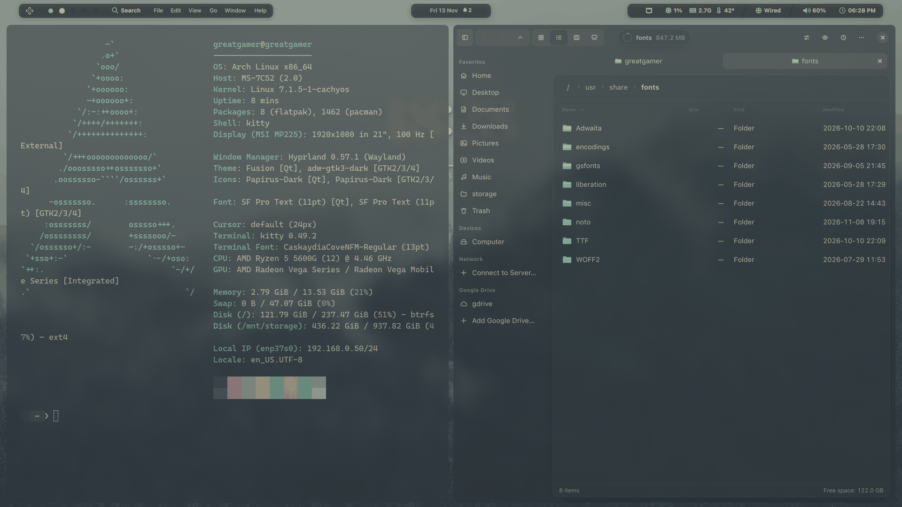

</div>

Cozytile turns a bare Hyprland install into a finished desktop. You get a floating bar, a dynamic island for
notifications and media, a macOS-style dock, a Spotlight-style launcher, a settings app, a Mission Control-style
overview, a desktop clock, and matching dotfiles for your terminal, prompt, lock screen, GTK and Qt apps. Everything
shares **one colour palette**, so the whole desktop looks like it belongs together.

It is a Wayland-native take on the [Cozytile](https://github.com/Darkkal44/Cozytile) look, originally made for Qtile/X11.

## Contents

- [Features](#features)
  - [The top bar](#the-top-bar)
  - [The dock](#the-dock)
  - [The launcher](#the-launcher)
  - [The dynamic island](#the-dynamic-island)
  - [Notifications](#notifications)
  - [Overview (Stage)](#overview-stage)
  - [The desktop clock](#the-desktop-clock)
  - [Wallpapers](#wallpapers)
  - [Power menu and lock screen](#power-menu-and-lock-screen)
  - [Frosted glass](#frosted-glass)
  - [Icon packs](#icon-packs)
  - [Display, input and power](#display-input-and-power)
  - [Hyprland, made easy](#hyprland-made-easy)
  - [Themed dotfiles](#themed-dotfiles)
- [Install](#install)
- [Requirements](#requirements)
- [Keyboard shortcuts](#keyboard-shortcuts)
- [Settings](#settings)
- [Theming](#theming)
- [Command line and scripting](#command-line-and-scripting)
- [Troubleshooting](#troubleshooting)
- [Project layout](#project-layout)
- [License and credits](#license-and-credits)

---

## Features

| | |
|---|---|
| **Top bar** | Workspaces, window title, global menu, system stats, network, volume, battery, tray, clock. One full-width bar or three floating islands |
| **Dynamic island** | Notifications, media controls, timer, lock-key and privacy indicators, and quick actions in one place |
| **Dock** | Magnifying dock with pinned and running apps, window previews, folder stacks, quick tools and Trash; adapts to fullscreen apps and games |
| **Launcher** | Apps, windows, calculator, conversions, files, emoji, clipboard, web search, commands, system actions |
| **Notifications** | Built-in daemon with history, actions, progress bars and Do-Not-Disturb |
| **Overview (Stage)** | Mission Control-style view of every desktop and window, with drag and drop and per-app desktop rules |
| **Settings app** | Themes, icons, bar, dock, display, windows, input, autostart, lock screen, power and more |
| **Desktop clock** | Minimal, stacked or analog, behind your windows, draggable |
| **Wallpapers** | Per-monitor picker, plus a theme built from the picture |
| **Themes** | Everforest, Sakura and from-wallpaper, applied to the shell and your apps |
| **Frosted glass** | An optional translucent, blurred look across the whole desktop |
| **Icon packs** | Browse, install, switch and remove icon themes for GTK, Qt, the launcher and the dock |
| **Global menu** | The focused app's menus in the bar, like macOS |
| **Lock screen, power menu, night light, monitors, idle** | Themed and configurable from Settings |
| **Scriptable** | Every action is an IPC call, so any keybind tool can drive it |

### The top bar

A floating bar with rounded caps (or a single full-width bar, your choice in Settings → Bar). The left holds the logo,
workspace dots, search and (optionally) the focused app's menus. The right holds CPU, RAM, temperature, network,
volume, battery, tray icons and the clock. Items you don't need can be hidden in Settings, and the bar drops optional
items automatically on narrow screens.

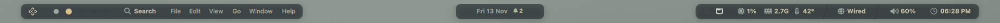

The logo's system menu (left-click the logo):

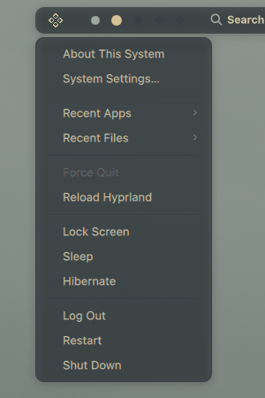

- **Logo**: left-click for the system menu (About This System, **System Settings**, recent apps and files, force quit, reload Hyprland, lock, sleep, ...), right-click for the power menu, middle-click for the wallpaper picker.
- **Volume**: click to mute, scroll to change, right-click for the output picker, middle-click to mute the mic.
- **Clock**: click to show the date. **Workspace dots**: click or scroll to switch.
- **Stats** (CPU, RAM, temperature): click one for a popup with its history.
- **Network, battery and notification items**: show status at a glance. The system tray holds your background apps.
- **Global menu**: turn it on in Settings → Bar to show the focused app's menus (File, Edit, View, ...) on the bar, like macOS. See [Global menu setup](#global-menu-setup).

### The dock

A macOS-style pill at the bottom of every screen. Icons magnify under the pointer, you can drag them to reorder, and
the whole thing adapts to what you are doing.


- **Pinned and running apps.** Right-click an icon to keep or remove it. Open apps that aren't pinned appear after a separator, and running apps get a dot per window (up to three), with an accent dash under the focused one.
- **Window peek.** Hover a running app to see its windows as live thumbnails. Click one to focus it (switching workspace if needed), or use the hover-revealed **×** to close just that window.
- **Right-click menu** on any item for its actions.
- **Folder stacks.** Pin a folder (or "Recent" files) and open it as a **Fan**, **Grid** or **List**. Click an entry to open it, or drag it out and drop it on another app. Drop a folder from your file manager onto the dock to add a stack, or run `qs -c cozytile ipc call dock addStack <path>`.
- **Trash.** The same Trash your file manager uses. Drop files on it to trash them.
- **Quick tools**, each with a panel and a keybind:
  - **Clipboard**: history you can copy again, pin or clear.
  - **Screenshot**: region, window or full screen, saved to `~/Pictures/Screenshots`, copied and notified.
  - **Notes**: a scratch note saved as you type.
  - **System monitor**: CPU, memory and temperature with history, disk use and network speed. It only samples while open.
  - **Screen recording**: start and stop from the dock.
- **Hiding.** *Never*: windows tile above it. *Intelligent*: hides while a window touches it. *Always*: hides until you point at the bottom edge.
- **Size.** Icon size is Auto (follows the screen width, shrinking when needed), Small, Medium or Large. Magnification is Off, Subtle, Normal or Large.
- **Context awareness.** A fullscreen app hides the dock on that screen. A fullscreen game, or `dock mode gaming`, swaps in a minimal dock (screenshot, record, system) on the overlay layer. Pausing on a folder opens Downloads, and icons that can't accept a dragged file dim. Switch it all off in Settings → Dock.
- **Keyboard.** `Super + Alt + 1` to `9` launches or focuses the nth app. Other binds are in [Keyboard shortcuts](#keyboard-shortcuts).

### The launcher

Press `Super + Space` (or `Super + D`) and start typing.

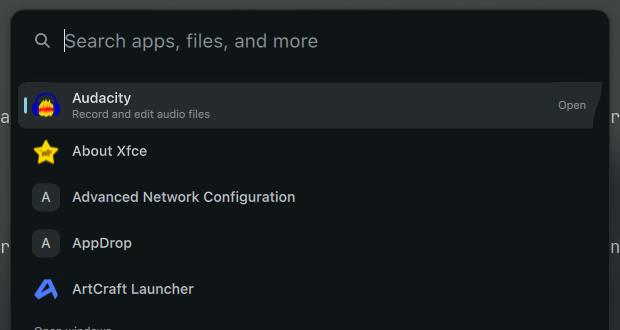

| Type | You get |
|---|---|
| `ffx` | Apps and open windows, with fuzzy matching |
| `12 km to mi` | Calculator and unit and currency conversion, as you type |
| `/` + name | Files |
| `g`, `yt`, `gh`, `w`, `so`, `aur`, `aw`, `mdn` + text | Web search |
| `:smile` | Emoji, with your recent ones first |
| `clip` | Clipboard history |
| `>` + command | Run a shell command |
| | System actions (lock, suspend, ...) |

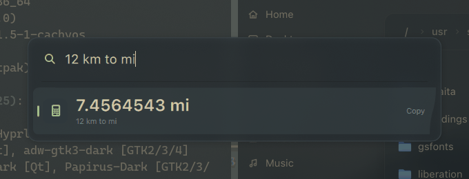
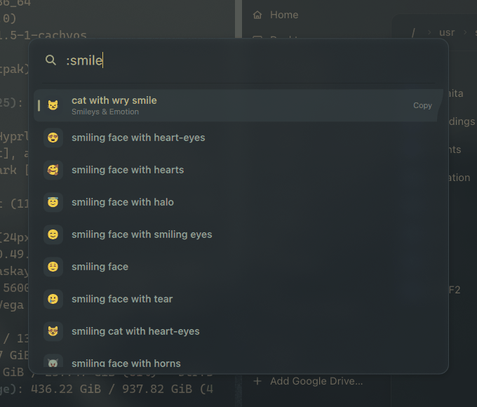

### The dynamic island

The island sits at the top centre and does three jobs:

- **Banners**: notifications, volume, microphone and brightness feedback pop up here, so there are no separate OSD popups.
- **Media**: shows what's playing, with play/pause and skip controls.
- **Panel**: click it to open the full card with the timer, notification history and quick actions (theme, wallpaper, microphone, night light, volume, power).

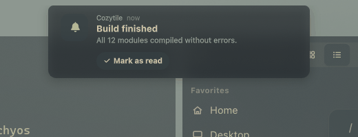
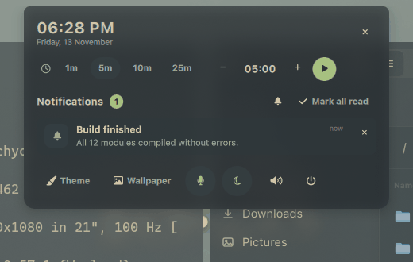

**Timers.** Pick a preset (1m, 5m, 10m, 25m) or a custom time. A countdown chip stays in the island while it runs,
and it rings with a pulse and a sound when finished. Click the island to silence it.

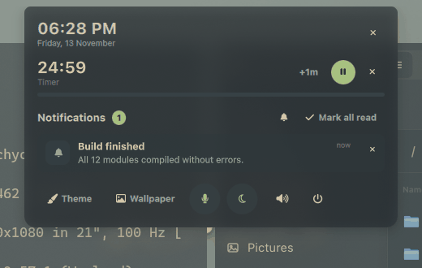

The island also tells you when **Caps Lock, Num Lock or Scroll Lock** is on, and when an app is using your
**microphone or camera**, and which app. It hides itself on narrow screens.

### Notifications

Cozytile includes its own notification daemon, so there is nothing extra to install. It supports actions, inline
replies, progress bars, a history you open from the island, and **Do-Not-Disturb** (toggle it from the island's
notification panel, from Settings → General, or with `ipc call notifications dnd`). Critical notifications still show
while Do-Not-Disturb is on.

### Overview (Stage)

Press `Super + Tab` for a Mission Control-style overview. Each Hyprland workspace is a **desktop** shown as a card
along the top, and below it are the windows of the selected desktop, zoomed out from their real positions with live
thumbnails.

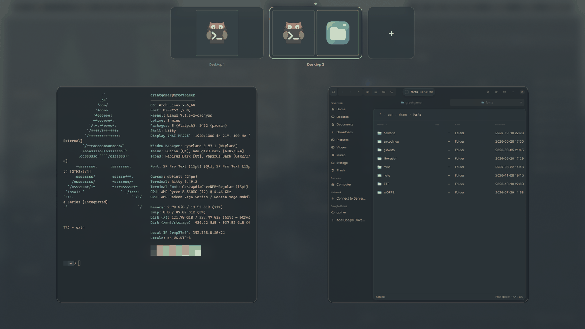

- Click a window to jump to it, or drag it onto another desktop (or the **+**) to move it.
- Create, rename and remove named desktops, and add **app rules** so an app always opens on a given desktop, with `ipc call stage create|rename|remove|rule` (see [Command line](#command-line-and-scripting)). Edge, corner radius and animation speed are stored under `stage` in the settings file.
- `Super + Ctrl + Tab` jumps to the next desktop. Windows are never closed by switching.

### The desktop clock

A clock on your wallpaper, behind your windows and click-through, so it never gets in the way. Choose a style, size,
font, 12 or 24-hour time, seconds and date, and drag it anywhere in Settings → Desktop.

| Minimal | Stacked | Analog |
|---|---|---|
| 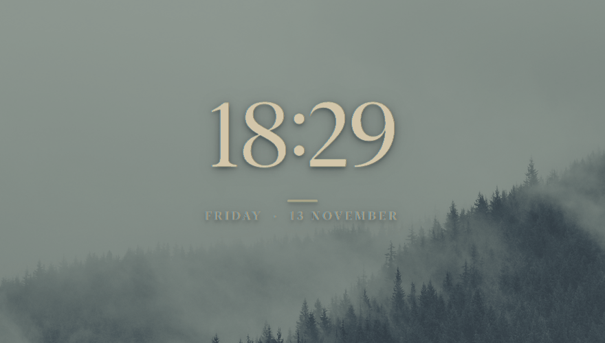 | 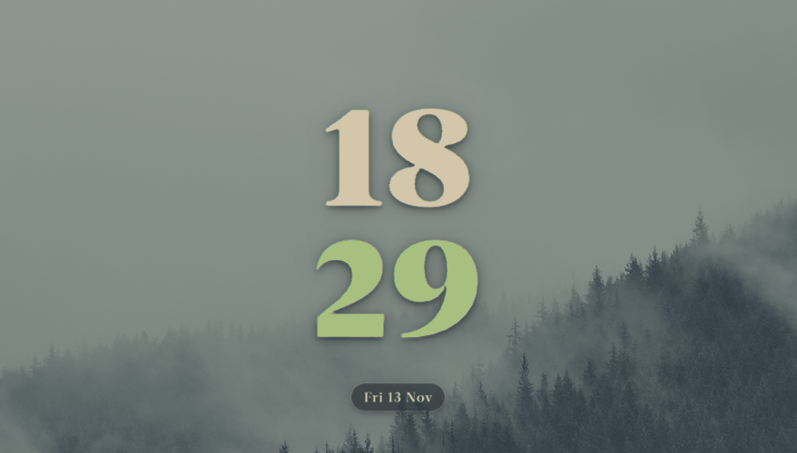 | 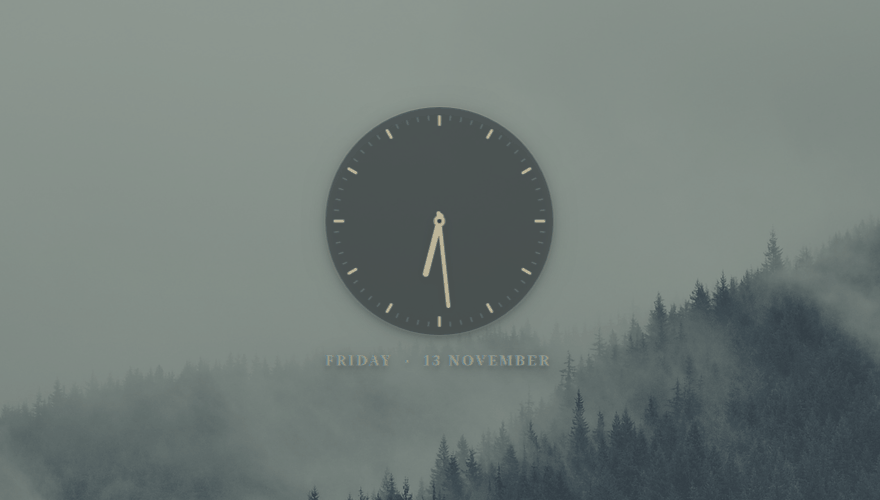 |

### Wallpapers

A thumbnail picker (`Super + Ctrl + O`) shows the images in the folders you choose. Each monitor can have its own
wallpaper, and **Theme from wallpaper** builds the whole colour scheme from the picture. Cozytile doesn't ship
wallpapers, so point it at your own folder.

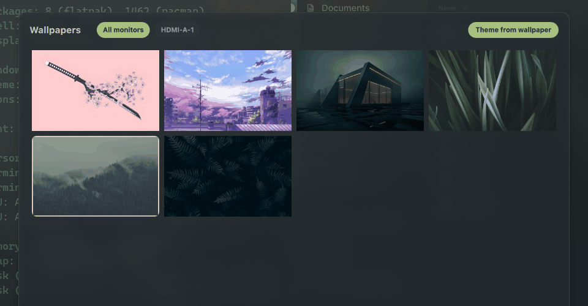

### Power menu and lock screen

`Super + X` opens a menu to **lock**, **log out**, **suspend**, **reboot** or **shut down**. Use the arrow keys and
`Enter`, or click.

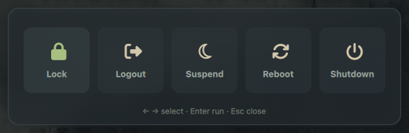

The lock screen (hyprlock) is themed to match. In Settings → Lock screen you can pick a background, set its blur and
brightness, and choose the clock size, font and 12 or 24-hour time. A live preview is shown. An optional SDDM login
theme matches it (`./setup.sh --sddm`).

### Frosted glass

Turn on **Frosted glass** in Settings → Appearance for a translucent look: the bar, island, dock, panels, terminal,
GTK/Qt apps, lock screen and login screen get a blurred, palette-tinted surface. Turn it off for solid surfaces.

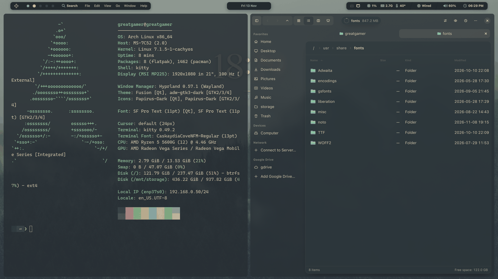

*Above: frosted glass off. The desktop at the top of this page has it on.*

### Icon packs

Settings → Icons lists the icon packs on your system with previews. Pick one and it applies everywhere: GTK and Qt
apps, the launcher and the dock. You can also install a pack from a `.tar.gz`, `.tar.xz` or `.zip` archive, an unpacked
folder or a download link (packs go to `~/.local/share/icons`), and remove the ones you added. The
shell restarts for a moment to load the new icons, and some apps need a restart too.

### Display, input and power

- **Night light** warms the screen, always or on a schedule. You can also dim all screens in software.
- **Monitors**: resolution, refresh rate, scale, rotation, position, VRR and on/off. Changes revert after 15 seconds unless you keep them, so you can't lock yourself out of a display.
- **Keyboard and mouse**: layouts, XKB options, key repeat, pointer speed and acceleration, focus-follows-mouse, natural scrolling, touchpad options and cursor hiding.
- **Power and idle**: when to lock, turn off the screen and suspend.
- **Autostart**: run any command or app at login, with an app picker. You can test-run, rename, reorder and toggle entries.

### Hyprland, made easy

Windows, gaps, rounding, borders, opacity, blur, shadows and animations all have sliders and toggles in
Settings → Windows. The layout can be dwindle, master or scrolling. Changes apply live and survive reloads.
Hyprland's own config stays readable and hand-editable, and the settings app writes only the values you change.

### Themed dotfiles

Besides the shell, Cozytile ships dotfiles that follow the same palette:

| App | What you get |
|---|---|
| **Hyprland** | A modular Lua config (appearance, animations, binds, rules, workspaces, startup) |
| **kitty** | Themed colours and font, translucent when frosted glass is on |
| **zsh + starship** | A themed prompt, with autosuggestions and syntax highlighting |
| **hyprlock, hypridle** | A themed lock screen and idle timeouts |
| **GTK 3/4 and Qt (qt6ct)** | Matching colours, with the adw-gtk theme as the base |
| **btop, cava, fastfetch** | Palette-matched configs |
| **SDDM** | An optional login theme |

---

## Install

On Arch or CachyOS, with an internet connection:

```sh
git clone https://github.com/shahriar-ridom/cozytile.git
cd cozytile
./setup.sh --dry-run         # 1. preview every change (touches nothing)
./setup.sh --packages        # 2. install the packages Cozytile needs
./setup.sh                   # 3. install the shell and link the dotfiles
```

Then log out, choose **Hyprland** at the login screen, and log in. That's it.

Want to try it in your current session first? Run `~/.config/quickshell/cozytile/scripts/launch.sh`.
`setup.sh` is safe to re-run. Anything it would replace is first moved to `*.bak-<timestamp>`.

### Other ways to install

| I want... | Run |
|---|---|
| The full desktop (recommended) | `./setup.sh` |
| Only the bar, island, dock and launcher, with my own Hyprland config | `./install.sh` |
| To try it without installing | `qs -p .` from the repo folder |
| The Cozytile login screen (SDDM) | `./setup.sh --sddm` (needs sudo) |
| To start with the Sakura theme | `./setup.sh --theme sakura` |

> The installed shell is a **copy** in `~/.config/quickshell/cozytile`. After you edit the QML, run `./install.sh`
> again, or use `qs -p .` to run straight from the repo.

### What the installer changes

- The shell goes to `~/.config/quickshell/cozytile`.
- Your themed config files are generated into `~/.config/cozytile/generated/`.
- These are **symlinked to this repo**, so editing them here updates your desktop right away:
  `~/.config/hypr`, `kitty`, `~/.zshrc`, and the GTK 3/4 settings. Qt (`qt6ct`) is rendered as well.

Edit the dotfiles in this repo, not in `~/.config`. Machine-specific settings (monitor layout, GPU) go in
`dotfiles/hypr/config/local.lua`, which `setup.sh` creates from `local.example.lua`. It is git-ignored.

### Undo and uninstall

```sh
./rollback.sh                # restores the previous shell install
./uninstall.sh               # removes the installed shell (your settings are kept)
./uninstall.sh --purge       # also removes your saved settings
```

The dotfile symlinks aren't removed automatically. To go back to your old config, restore the `*.bak-<timestamp>`
copies next to them.

---

## Requirements

| Needed | Why |
|---|---|
| **Hyprland 0.55 or newer** (Lua config) | The window manager. The bundled config is `hyprland.lua` |
| **Quickshell 0.3 or newer**, built with Hyprland, PipeWire, MPRIS, Notifications, SystemTray, UPower and Networking | The bar, island, dock, launcher and settings app |
| **CaskaydiaCove Nerd Font** | Icons and monospace text. Any Nerd Font works; set `Theme.fontMono` in `config/Theme.qml` |
| **SF Pro Text** (optional) | The UI font. It isn't in the Arch repos, so Qt falls back to another sans font. Pick any font in Settings → Appearance |

`./setup.sh --packages` installs everything in `packages.txt`. Optional extras, each unlocking a feature:

| Tool | Unlocks |
|---|---|
| `awww`, `swww`, `hyprpaper` or `swaybg` | Wallpapers |
| `matugen` | The from-wallpaper theme |
| `hyprlock` | The lock screen |
| `hypridle` | Idle timeouts |
| `hyprsunset` | Night light |
| `brightnessctl` | Screen brightness keys |
| `playerctl` | Media keys |
| `hyprshot`, `grim`, `slurp` | Screenshots |
| `cliphist`, `wl-clipboard` | Clipboard history (launcher and dock) |
| `kitty`, `zsh`, `starship` | The themed terminal and prompt |
| `papirus-icon-theme`, `adw-gtk-theme`, `qt6ct` | Default icons and toolkit theming |
| `python3` + PyGObject | The global menu |

> **Important:** only one notification daemon can run at a time. Stop any others first (`dunst`, `swaync`, `mako`, ...).

---

## Keyboard shortcuts

`Super` is the Windows/Command key. The full list lives in `dotfiles/hypr/config/binds.lua`.

**Apps and shell**

| Keys | Action |
|---|---|
| `Super + Return` | Terminal (kitty) |
| `Super + Shift + Return` | Floating terminal |
| `Super + B` | Browser (Zen) |
| `Super + E` | File manager (Luma) |
| `Super + C` | VS Code |
| `Super + N` | Neovim in the terminal |
| `Super + Space` or `Super + D` | Launcher |
| `Super + Tab` or `Super + Alt + S` | Overview |
| `Super + Alt + 1` to `9` | Launch or focus the nth app in the dock |
| `Super + Alt + V`, `P`, `N`, `M` | Dock tools: clipboard, screenshot, notes, system monitor |
| `Super + Alt + G` | Toggle the dock's gaming mode |
| `Super + Ctrl + Tab` (`+ Shift` for previous) | Next desktop |
| `Super + A`, `Super + Shift + N` or `Super + Shift + I` | Island (notifications, media, timer) |
| `Super + Shift + T` | Next theme |
| `Super + Ctrl + O` | Wallpaper picker |
| `Super + X` | Power menu |
| `Super + Ctrl + L` | Lock screen |

The browser, file manager and editor binds are personal defaults. Change them in `binds.lua` to the apps you use.

**Windows and layout**

| Keys | Action |
|---|---|
| `Super + Q` | Close window |
| `Super + V` | Toggle floating |
| `Super + Ctrl + C` | Centre a floating window |
| `Super + F` | Fullscreen (covers the bar) |
| `Super + Shift + F` | Maximise (keeps the bar and gaps) |
| `Super + S` | Toggle split direction |
| `Super + P` | Pseudo-tile |
| `Super + M` | Swap with master |
| `Super + H / J / K / L` | Move focus left / down / up / right |
| `Super + Shift + H / J / K / L` | Move the window in that direction |
| `Super + Mouse drag` | Move a window |
| `Super + Right-drag` | Resize a window |
| `` Super + ` `` | Toggle the scratchpad |
| `Super + O` | Toggle the Obsidian scratchpad |

**Workspaces**

| Keys | Action |
|---|---|
| `Super + 1 ... 0` | Go to workspace 1-10 |
| `Super + Shift + 1 ... 0` | Move the window to workspace 1-10 |
| `Super + Mouse wheel` | Previous / next workspace |

**Screenshots** (saved to `~/Pictures/Screenshots`)

| Keys | Action |
|---|---|
| `Super + Shift + S` | Region |
| `Super + Ctrl + S` | Whole screen |
| `Super + Shift + W` | A window |

**Session:** `Super + Shift + R` reloads Hyprland, `Super + Shift + E` exits it.

**Media and hardware keys:** volume, mute, brightness and play/pause/next/previous are bound by default. Volume and
brightness show their feedback in the island. Caps, Num and Scroll Lock keys refresh the island's lock indicators.

---

## Settings

Open the settings app from the logo's menu in the bar (**System Settings...**), or run `qs -c cozytile ipc call settings toggle`. Jump straight to a page with:

```sh
qs -c cozytile ipc call settings open <page>
```

Pages: `appearance`, `icons`, `desktop`, `lock screen`, `bar`, `dock`, `general`, `display`, `windows`, `input`, `autostart`, `power`, `about`.

| Group | Page | What's in it |
|---|---|---|
| Personalise | **Appearance** | Colour scheme, from-wallpaper theme, app syncing, frosted glass, interface and monospace fonts |
| Personalise | **Icons** | Installed icon packs with previews, install from a URL or archive, remove packs |
| Personalise | **Desktop** | Wallpapers and folders, desktop clock style, position, size, font, 24-hour time, seconds, date |
| Personalise | **Lock screen** | Background, blur, brightness, clock size, font, 12/24-hour time, live preview |
| Shell | **Bar** | Bar style, global menu, window title, workspace numbers, temperature, stats refresh |
| Shell | **Dock** | Show or hide, icon size, magnification, quick tools, Trash, folder stacks, context awareness, running and pinned apps |
| Shell | **General** | Do-Not-Disturb, clearing notifications, OSD duration, reload Hyprland, restart the shell |
| System | **Display** | Night light and schedule, software dimming, monitors (resolution, refresh, scale, rotation, position, VRR) |
| System | **Windows** | Layout (dwindle, master, scrolling), gaps, rounding, borders, opacity, blur, shadows, animations |
| System | **Input** | Keyboard layouts, XKB options, key repeat, pointer speed, acceleration, touchpad, cursor |
| System | **Autostart** | Commands and apps started at login |
| System | **Power & idle** | Lock, screen-off and suspend timeouts, lock now, power menu |
| | **About** | System info and config file locations |

| Appearance | Bar |
|---|---|
| 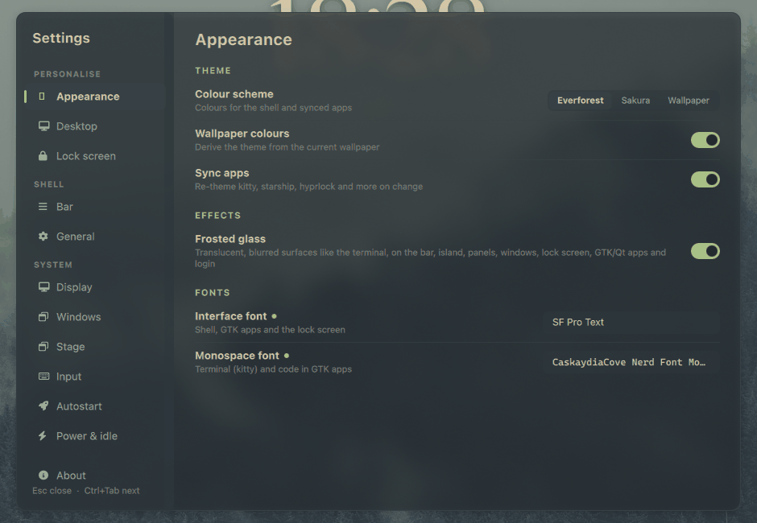 | 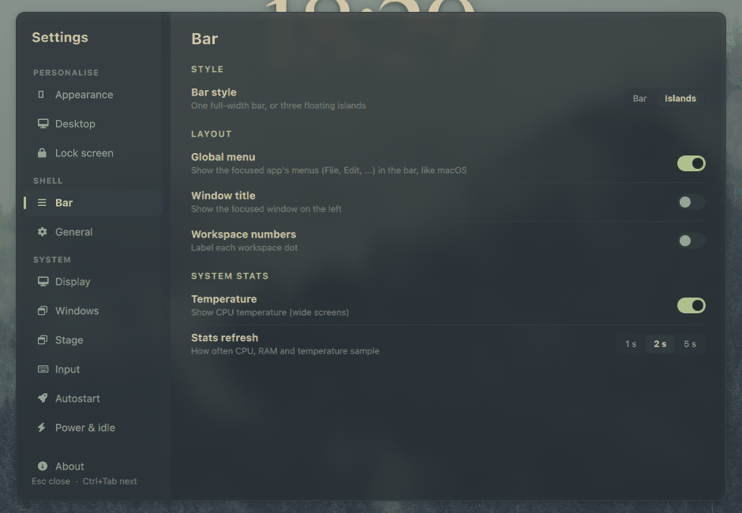 |
| **Desktop** | **Display** |
| 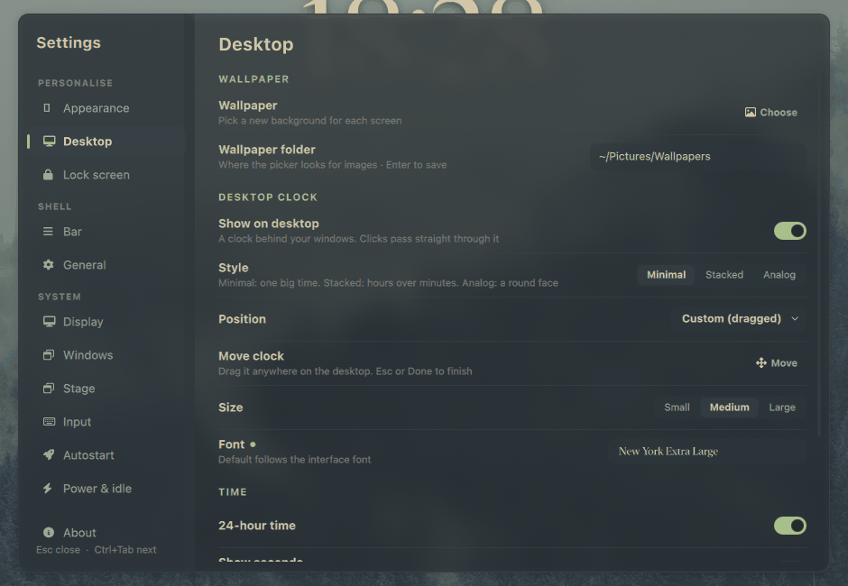 | 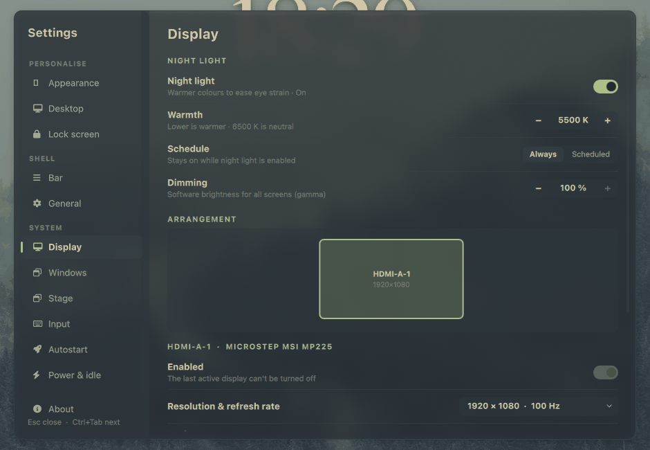 |
| **Windows** | **Input** |
| 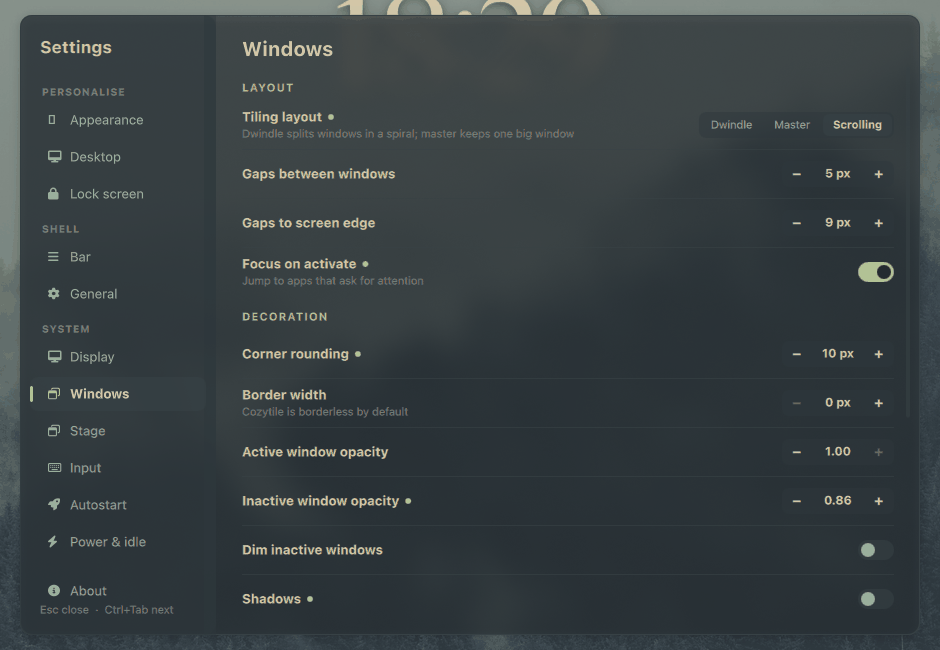 | 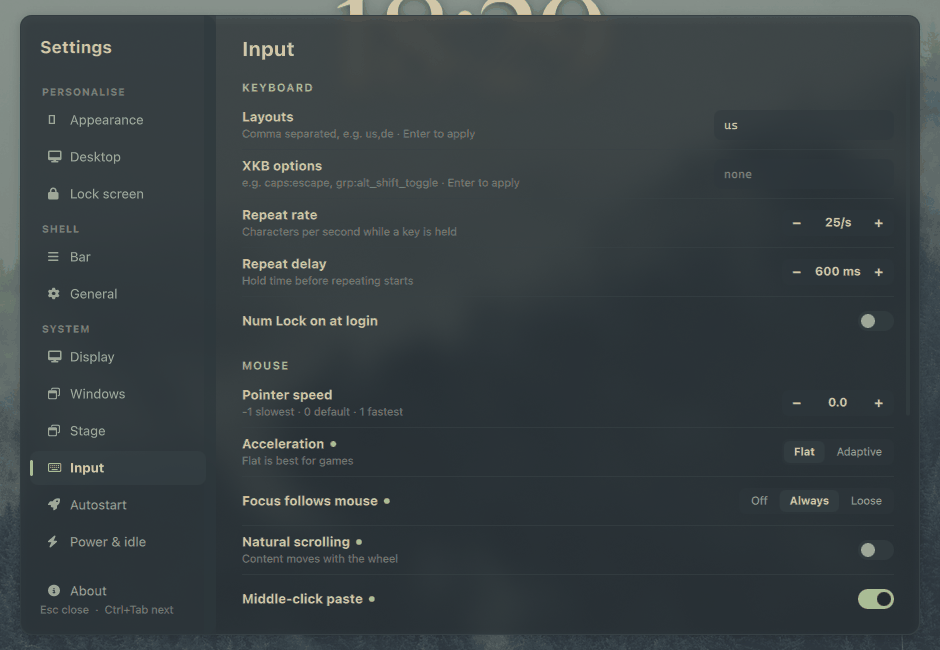 |
| **Lock screen** | **General** |
| 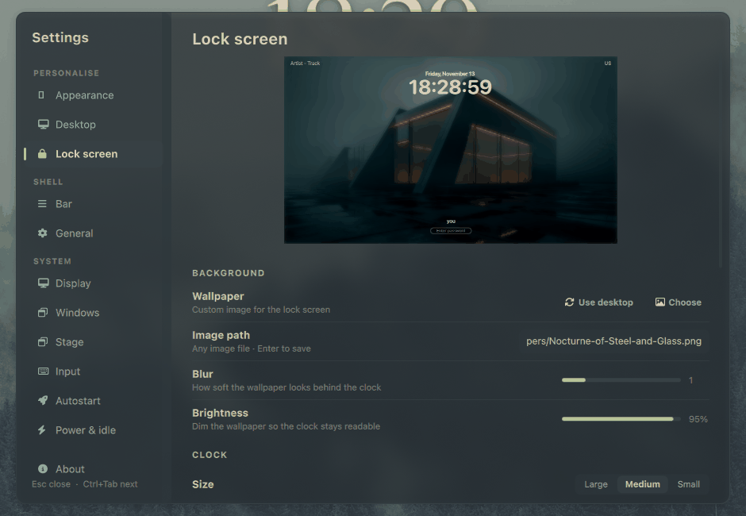 | 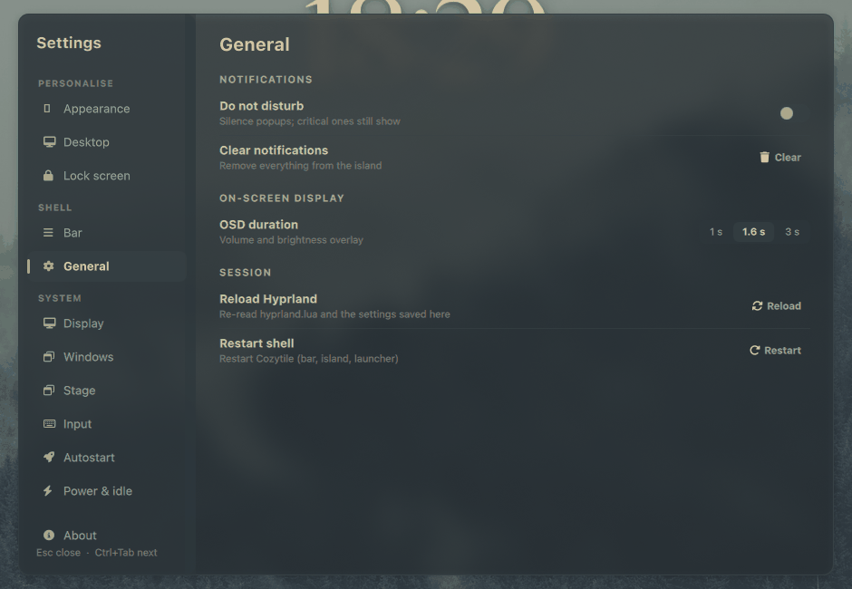 |
| **Power & idle** | |
| 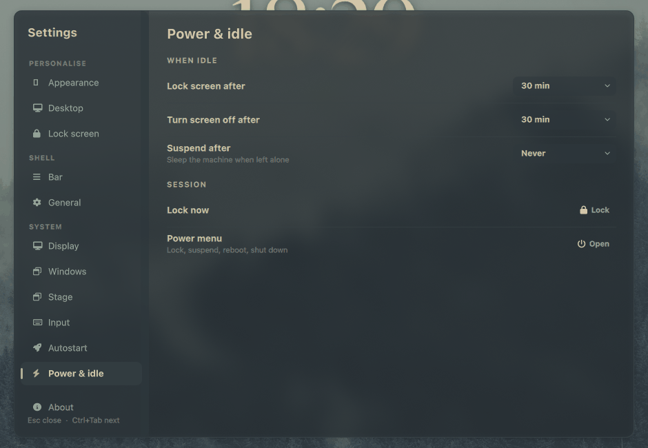 | |

**Good to know**

- Hyprland changes apply live and are saved to `~/.config/cozytile/generated/hypr/cozytile_settings.lua`, which loads after the shipped config. Your choices survive reloads.
- A small accent-coloured dot next to a setting means you've changed it from the default. Click the dot to go back.
- The settings app remembers the page you last used. Press `Esc` to close and `Ctrl + Tab` for the next page.

### Settings file

Settings are saved to `~/.local/state/cozytile/settings.json` and reload live. Keys include `theme`,
`syncDotfiles`, `wallpaperDirs`, `wallpapers`, `wallpaperTheming`, `osdTimeout` (ms), `showWorkspaceNumbers`,
`showWindowTitle`, `globalMenu`, `dnd`, `showTemp`, `statsInterval` (ms), `frostedGlass`, `desktopClock`, `stage`,
`dock*` (pinned apps, stacks, tools, hiding, size) and `lockscreen`. The settings app also stores `hypr` (Hyprland
overrides), `monitors`, `autostart` and `idle`.

Design tokens (fonts, bar height, margins, radii, animation timings) are in `config/Theme.qml`.

---

## Theming

Cozytile ships two colour schemes, **Everforest** (default) and **Sakura**, plus an optional **from-wallpaper** theme
that derives its colours from your picture with `matugen`. Switch with `Super + Shift + T` or in Settings → Appearance.

A theme change re-colours the bar, island, dock, launcher and settings, and re-themes the apps you've hooked up (kitty,
starship, hyprlock, GTK, Qt, btop, cava and fastfetch) from the same palette. Turn **Sync apps** off in Settings →
Appearance if you only want the shell recoloured.

**Adding a theme.** The palettes live in `config/palettes.json`, the one source used by both the shell and the
dotfile renderer (`dotfiles/render.py`). Add an entry with the same keys as the existing ones
(`bg bg2 bg3 dim fg fg2 muted green blue yellow orange red purple accent workspaceActive`) and add its name to
`themeNames` and `themeLabels` in `config/Theme.qml`. Every component uses semantic colour roles, so a new theme
recolours everything automatically.

### Global menu setup

Apps run natively on Wayland. Native apps can't register their menus with the registrar (they have no X11 window id),
so the bridge (`scripts/globalmenu.py`) finds them on the session bus through the focused window's process instead.

- Qt apps (Dolphin, ...) need nothing.
- Firefox-family browsers need `widget.gtk.global-menu.enabled` and `widget.gtk.global-menu.wayland.enabled`.
  `scripts/menu-launchers.sh` writes both into every LibreWolf, Zen and Firefox profile's `user.js` (restart the
  browser afterwards) and deletes the XWayland launcher overrides that older versions wrote. `--remove` takes the prefs out.
- An app with several windows shows the menu of its newest window: nothing on the bus says which menu belongs to
  which Wayland window.
- Some apps never export a menu. kitty has no global-menu support on Linux.

---

## Command line and scripting

Every action is an IPC call, so any keybind tool can use them:

```sh
qs -c cozytile ipc call launcher toggle|open|close
qs -c cozytile ipc call launcher search "5 km to miles"
qs -c cozytile ipc call notifications toggle|clear|dnd
qs -c cozytile ipc call island toggle|close
qs -c cozytile ipc call timer start 5m|90s|1h30m|25:00   # also: stop, toggle, add 1m, status
qs -c cozytile ipc call workspace goto <n>|next|prev
qs -c cozytile ipc call stage overview|next|prev|goto <n>|list
qs -c cozytile ipc call stage create|switchTo|rename|remove <name>   # also: moveWindow <n>, rule <class> <desktop>
qs -c cozytile ipc call dock toggle|gaming|item <n>|tool clipboard|screenshot|notes|system|record
qs -c cozytile ipc call dock mode normal|hidden|gaming|auto   # also: addStack <path>
qs -c cozytile ipc call wallpaper toggle|set <path>
qs -c cozytile ipc call theme next|set sakura|get
qs -c cozytile ipc call frost toggle|on|off|get
qs -c cozytile ipc call clock toggle|on|off|move|style minimal|stacked|analog
qs -c cozytile ipc call audio up|down|mute|micMute
qs -c cozytile ipc call brightness up|down|kbdUp|kbdDown
qs -c cozytile ipc call nightlight toggle|on|off|status   # also: temperature 4000, dim 80
qs -c cozytile ipc call power toggle
qs -c cozytile ipc call settings toggle|open <page>
```

Run `qs -c cozytile ipc show` for the full, current list. To re-render the themed dotfiles for a theme:

```sh
~/.config/cozytile/theme-apply.sh sakura
```

Only apps you've set up are reloaded.

---

## Troubleshooting

| Problem | Fix |
|---|---|
| **No notifications** | Another daemon owns them. Check with `busctl --user status org.freedesktop.Notifications`, then stop it. |
| **Missing icons or empty boxes** | Install a Nerd Font and set `Theme.fontMono` in `config/Theme.qml`. |
| **Wallpaper doesn't change** | Run `scripts/wallpaper.sh /path/to/image.png` in a terminal to see the error. |
| **No temperature shown** | No sensor was found (`k10temp`, `coretemp` or `zenpower`). The item hides itself. |
| **Dock is missing** | Check Settings → Dock → Show dock. It also hides for fullscreen apps and when set to *Always* hide. |
| **App icons look wrong** | Pick another pack in Settings → Icons. Qt caches drawn icons, so applying a pack restarts the shell. |
| **Installer says a module is missing** | Your Quickshell build lacks a service module. Rebuild it with the modules listed in [Requirements](#requirements). |
| **Shell fails to load after editing QML** | One QML error stops the whole shell. Lint with `qmllint <files>`, then check the log with `qs -c cozytile log`. |
| **No global menu for an app** | See [Global menu setup](#global-menu-setup). |
| **Something else looks wrong** | Check `~/.cache/quickshell`, or run `qs -c cozytile log`. |

On narrow screens, the bar drops optional items: network and temperature below 1500 px, and search, CPU and RAM below 1150 px.

---

## Project layout

| Path | What's inside |
|---|---|
| `shell.qml` | The entry point: IPC handlers, the bar, island, dock, desktop clock, and overlays |
| `config/` | Settings, the theme, and the palette (`palettes.json`) |
| `services/` | Stateless services: audio, network, media, notifications, timer, stage, dock, windows, frosted glass, icons, and more |
| `modules/` | The UI, one folder per feature (bar, dock, island, launcher, settings, stage, power, wallpaper, clock, ...) |
| `components/` | Shared widgets (toggle, dropdown, segmented control, slider, ...) |
| `scripts/` | Helper scripts: wallpapers, theme switching, icon packs, screenshots, global menu, recent files |
| `dotfiles/hypr/` | Hyprland config (`hyprland.lua`, `config/*.lua`), idle, lock and helper scripts |
| `dotfiles/kitty`, `zsh`, `gtk`, `qt6ct`, `sddm` | Terminal, shell, toolkit and login-screen settings |
| `dotfiles/templates/` + `render.py` | Renders themed configs from `config/palettes.json` |
| `packages.txt` | Arch and CachyOS package list |
| `docs/screenshots/` | Screenshots used in this README |

Contributing: there is no build step and no test suite. Run the shell from the repo with `qs -p .`, lint with
`qmllint`, and launch it once after any QML change, because a single error stops the whole config from loading.

---

## License and credits

Cozytile is released under the [MIT License](LICENSE).

Its look is inspired by the original [Cozytile](https://github.com/Darkkal44/Cozytile) for Qtile.
Built with [Quickshell](https://quickshell.org) and [Hyprland](https://hyprland.org).
